# Shoebox UX audit and redesign (Nov 2026)

A walk through every screen of the Android app and the desktop (Mac) app. It covers what the app offers, where it gets in people's way, and a redesign that puts the everyday jobs first, with a phased plan to build it. This is a report and mockups only: no app code was changed.

| What | Where |
|---|---|
| UX mind map (every screen, feature, setting; platform, depth, frequency) | [mindmap.md](mindmap.md) (Mermaid + tables) · [mindmap.html](mindmap.html) (collapsible) |
| Findings F1–F26 with screenshot references | [findings.md](findings.md) |
| Screenshot index and how each was reached | [capture-log.md](capture-log.md) |
| Screenshots | [screenshots/android/](screenshots/android) (34) · [screenshots/desktop/](screenshots/desktop) (29) |
| Redesign mockups (open in a browser) | [mockups/index.html](mockups/index.html) |
| Mockup renders | [mockups/png/](mockups/png) |

> **Privacy.** `screenshots/android/` was captured on the owner's real library and shows personal photos, faces, names and folder names. Keep it out of any public copy of the repo. The desktop screenshots use a throwaway demo library of synthetic images.

## How the audit was done

- **Android.** Samsung S25 (SM-S931B) over adb, with the live library (5,275 photos, 3 devices), in dark and light themes. Screens were driven with `input tap/swipe` and located with `uiautomator dump`. Only reversible actions were used: sheets were opened and dismissed, selections cleared, nothing deleted, shared, paired or imported.
- **Desktop.** The same Svelte UI as `/Applications/Shoebox.app`, run through `desktop-dev-server` against a demo library (`xtask fixtures --preset small`) at 1280×800. Computer-use tools weren't available in this session, and the native window captured blank from another Space. Running the dev server let onboarding, album creation, sharing and invites be tried without touching real data. The native app differs only where native pickers or the Mac Photos library are involved.
- **Code.** Every screen and component in `apps/desktop-mobile/ui/src` was read to find states that couldn't be reached live (pairing check, recovery requests, banners) and to confirm causes (album covers, theme at launch, the safety rule).
- **Lens.** Each feature was rated by how often a typical person needs it. The audit then checked how many taps it takes, how visible it is, and whether it follows Nielsen's heuristics and platform conventions (Material 3 on Android, the macOS HIG on Mac).

## What we found

The app has about 70 distinct features and settings (see the mind map). Its foundations are strong: a calm visual language, a fast timeline, good search, and honest copy about connections. The problems are about **placement and consistency, not missing features**. Almost everything is exposed at the same level, so the jobs people do every day compete with ones they do once a year.

| Job | How often | Today | Verdict |
|---|---|---|---|
| Look at photos | daily | 0 taps | ✅ good |
| Know they're safe | daily glance | four places, which disagree | ❌ the product's core promise is unclear |
| Send a photo to someone | weekly | no Share in the viewer; 3+ taps, with system share second | ❌ too deep |
| Find a photo | weekly | small header icon | ⚠️ good engine, weak entry point |
| Albums and sharing | monthly | two parallel worlds (Albums / Shared) | ⚠️ |
| Add a device | rare | role jargon first | ⚠️ |
| Change a setting | rare | one page with 14 flat sections | ⚠️ |

**Top findings** (full list in [findings.md](findings.md)):

1. **F1. Three different answers to "are my photos safe?"** On the same library:
   - Storage says *"Every photo has at least 2 copies"*, while its own chart shows every photo at 1 copy.
   - Devices says *"Everything is backed up"*.
   - The viewer shows a red *"1 copy · wants 2"*.

   The core rule (safe = enough copies **or** held by a keeper) is right. The UI words it as if it were only about copies, and the viewer ignores it.
2. **F2. No Share in the viewer.** In the selection share sheet, "Other apps…" comes second, below a "New shared album" field.
3. **F3. Delete carries the same weight as Info.** Selection actions are unlabeled icons (≈ ⤓ ⊞).
4. **F4. The phone shows desktop path fields** (`/Users/you/…`) for Watched folders and Export.
5. **F5 and F6. Albums and Shared are separate sections** with different viewers, and two different "share" buttons on an album. Album covers never show: the stored cover is never set and there is no fallback.
6. **F8. Navigation doesn't follow frequency.** Devices gets a whole phone tab. Favorites hides in an avatar sheet titled "This device", and People is only reachable from inside Albums.
7. **F9. Settings is one flat page, 4½ phone screens long.**
8. **Bugs found along the way:**
   - F16: the saved theme isn't applied at launch.
   - F13: Android Back while a sheet is open leaves the screen instead of closing the sheet.
   - F17: light-mode status-bar icons are invisible.
   - F19: copy errors such as "1 copies".
   - F25: the `--danger` token is undefined.

## Redesign

### Principles

1. **Frequency decides placement.** Daily and weekly jobs take 0–1 taps. Monthly jobs take 2. Rare or risky options sit behind one clearly labelled door (Advanced, a ⋯ menu).
2. **One safety truth.** The rule is computed once and shown in the same words on Photos, Backup, the viewer and banners. It is quiet when all is well and loud, with a reason and one action, when something is wrong (from `design/README.md`).
3. **Progressive disclosure.** Show the answer, then the details. For example, Backup shows a sentence, then the devices, then Details with the queue and chart.
4. **Plain words over roles.** Say "Keeps every original", not "Keeper". The role names stay as small labels for people who learned them.
5. **Platform conventions.**
   - Android: a Material 3 navigation bar, bottom sheets that consume Back (predictive back), the system share sheet.
   - Mac: a sidebar plus toolbar, menu-bar commands and shortcuts, a two-pane Settings window (⌘,), right-click menus.
6. **Ergonomics and access.**
   - Primary actions sit in the bottom thumb zone on phones.
   - Touch targets are at least 48 dp / 44 pt.
   - Every icon has a label in action bars.
   - Body text is 15 px or more on phones, and text meets WCAG AA contrast with the existing tokens.
7. **Keep what works.** The tokens, palette, timeline, search chips and connection honesty all stay. This is a restructure, not a restyle.

### What changes, by area

| Area | Change | Fixes | Mockup |
|---|---|---|---|
| **Navigation** | Phone tabs **Photos · Albums · Search · Settings**. The avatar menu goes. A status chip on Photos shows the one safety signal and opens the Backup page in one tap. Backup is the first section of the Settings tab. The desktop sidebar is grouped (Library / Albums / a Backup status row / Settings at the bottom). | F8, F15, F18, F20 | [01](mockups/01-navigation.html) · 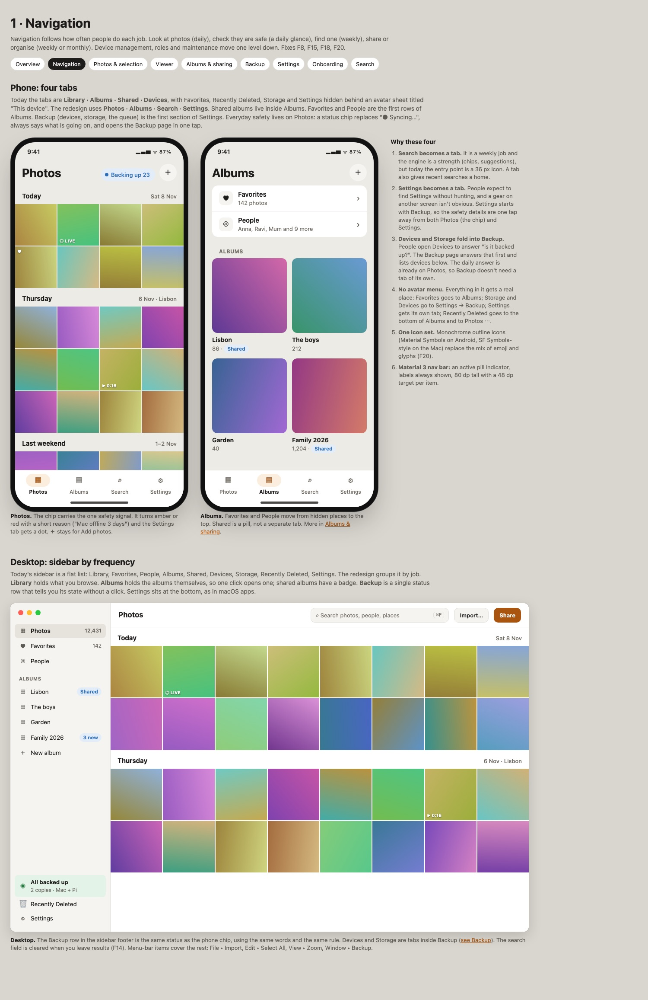 |
| **Photos and selection** | Sparse days share a row. Zooming out groups by month. The selection bar is labelled **Share · Add to album · Favorite · More · Delete**, with Delete last and red. On desktop the selection bar lives in the toolbar, plus a right-click menu. | F3, F23 | [02](mockups/02-photos.html) · 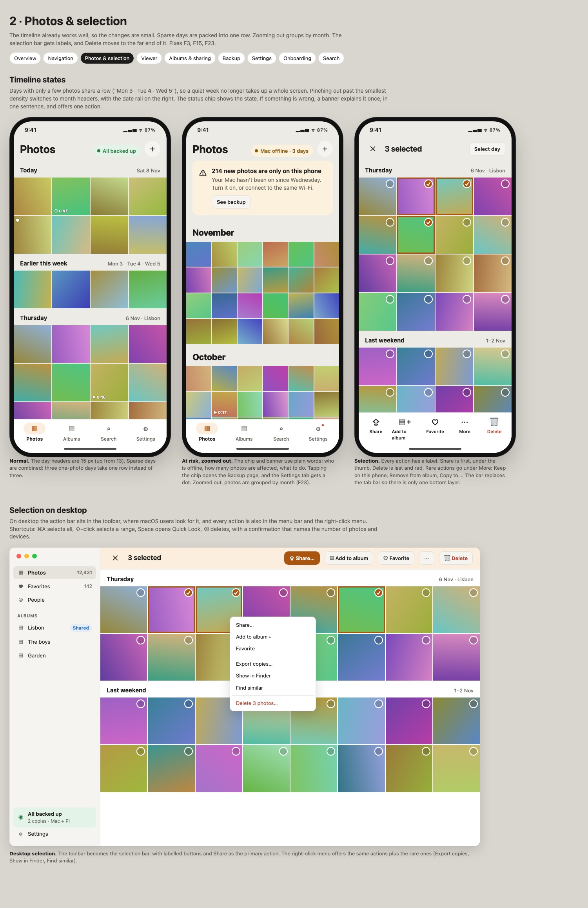 |
| **Viewer** | A bottom bar **Share · Favorite · Info · Delete**. Rare actions go in ⋯ and appear only when they apply. Info is a sheet that says "Backed up · on Mac and Pi". Shared albums use the same viewer. | F2, F3, F5, F22 | [03](mockups/03-viewer.html) · 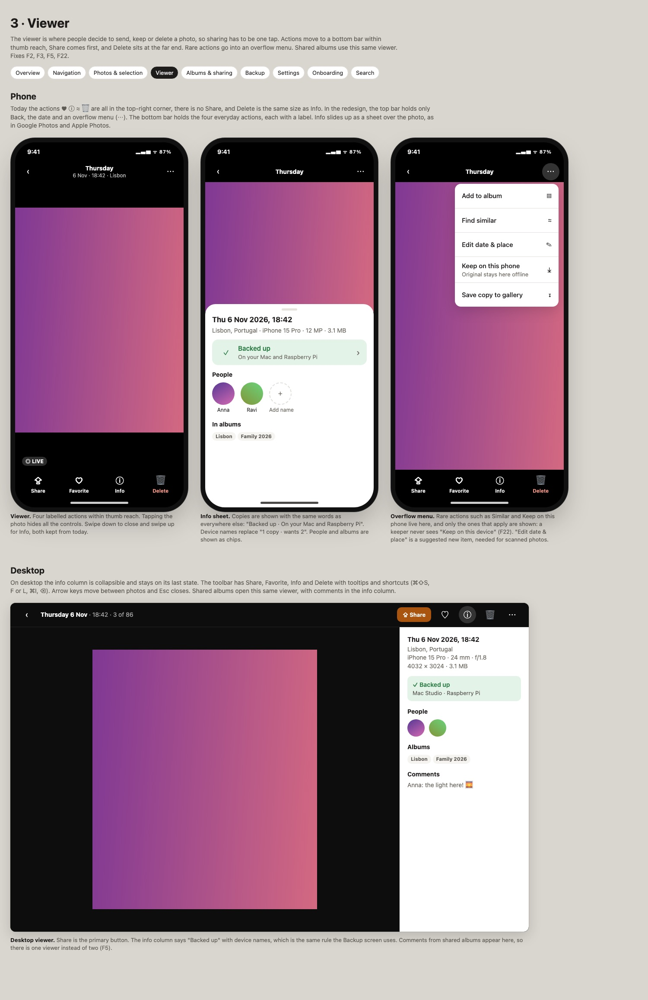 |
| **Albums and sharing** | One list with a Shared pill. Covers fall back to the newest photo. The album name is the title. **Add photos** is the primary action. One **Share** button offers *Invite people / Web link / Send copies*. The selection share sheet puts system apps first. Invitations are sent through the system share sheet, with QR as the second choice. | F2, F5, F6, F7, F11, F12 | [04](mockups/04-albums-sharing.html) · 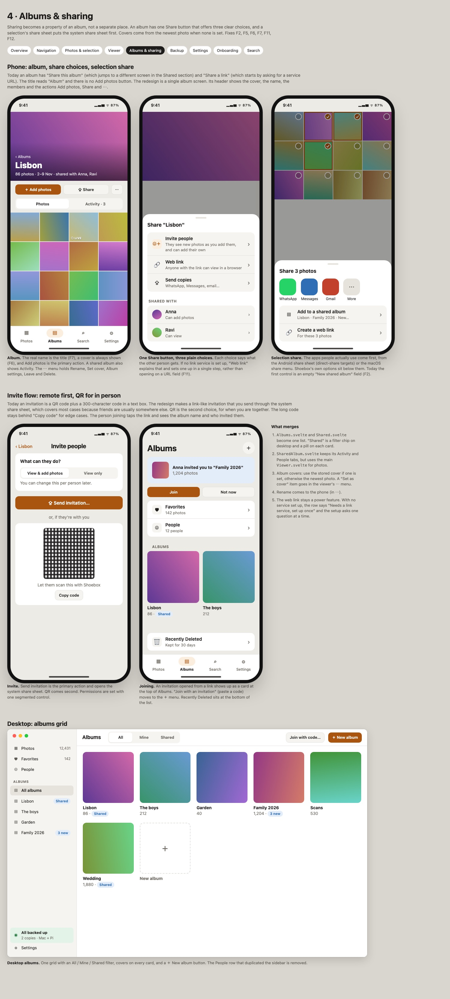 |
| **Backup** (merges Devices + Storage; first section of the Settings tab on phones, a sidebar row on the Mac) | A hero sentence: *All 12,431 photos are on 2 devices* / *214 waiting for your Mac* / *1,203 only on this phone*. Device cards sit below it. The queue, copies chart, activity and free-up live under **Details**. Device actions show only when they apply. Add a device shows the QR first, with the role picked automatically. | F1, F10, F15, F22 | [05](mockups/05-backup.html) · 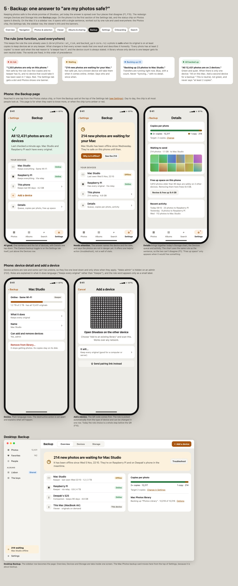 |
| **Settings** | Its own phone tab. It opens with the Backup section (safety sentence, Camera backup toggle, Devices, phone storage), then seven drill-in groups: Camera backup · Photos on this phone · Search & People · Appearance · You & this device · Recovery kit · **Advanced**. Advanced holds copies, web link service, relays, rebuild, diagnostics, replace phrase and leave. Desktop-only controls are hidden on the phone. The Mac gets a two-pane window with search. | F4, F9, F13, F16, F24 | [06](mockups/06-settings.html) · 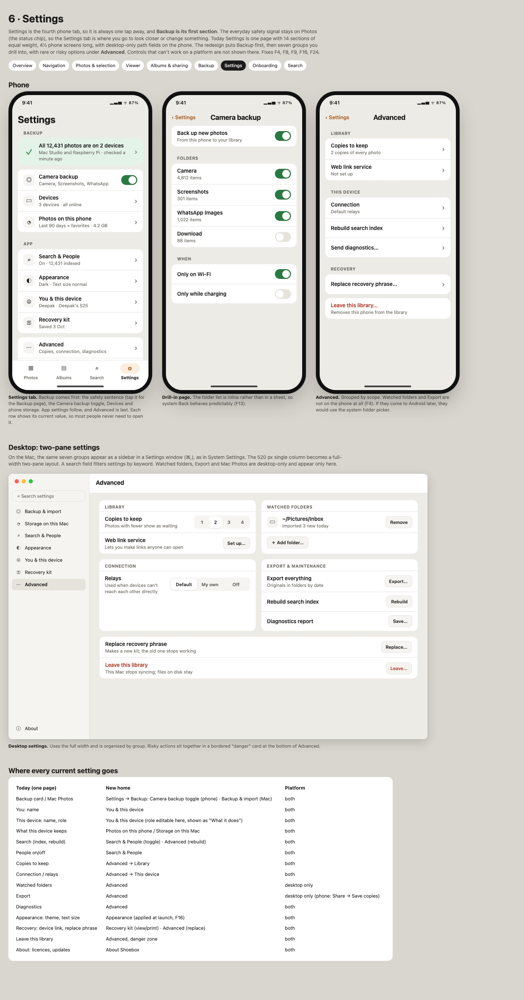 |
| **First run** | Welcome → name (role chosen silently) → recovery kit (can be postponed, with a persistent reminder that also counts as "at risk") → bring photos in (camera backup on, add a computer, Google import). Empty states that teach the next step. | F10 | [07](mockups/07-onboarding.html) · 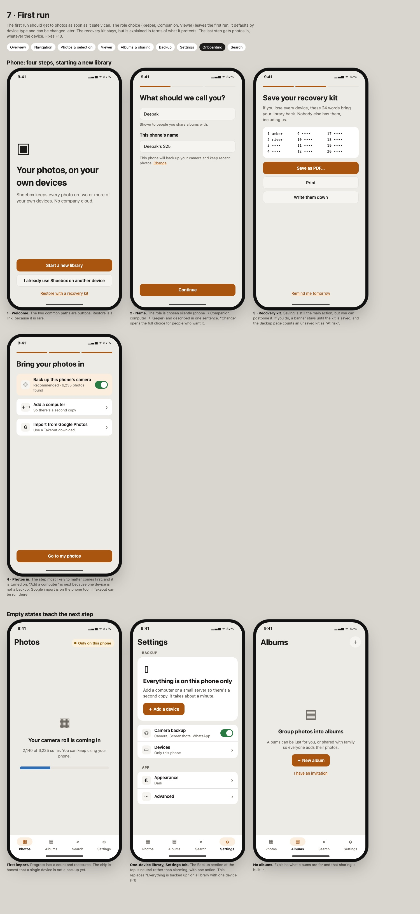 |
| **Search** | A tab with people, places and recent searches. The keyboard closes on submit, the desktop query clears when you leave results, and "no results" suggests dropping a chip. | F8, F14 | [08](mockups/08-search.html) · 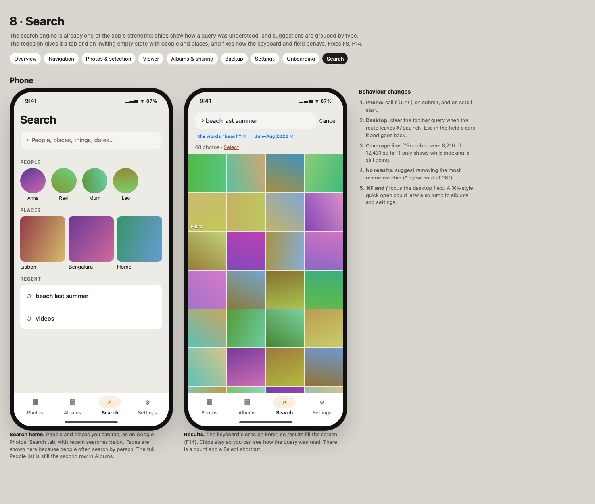 |

Dark-theme renders: [01-navigation-dark](mockups/png/01-navigation-dark.jpg), [05-backup-dark](mockups/png/05-backup-dark.jpg).

### Before and after

| Before | After |
|---|---|
| 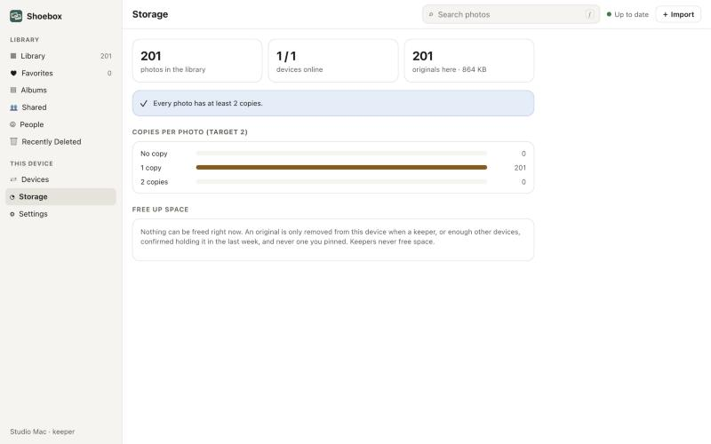 Storage says "at least 2 copies" over a chart of 1-copy photos | Backup: one sentence from one rule ([05](mockups/05-backup.html)) |
| 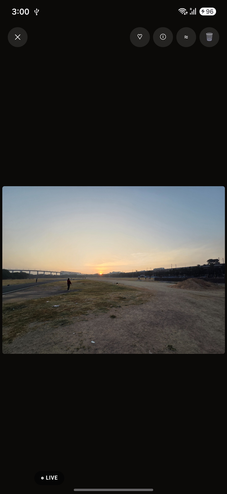 Viewer: no Share, Delete in the top cluster | Bottom bar Share · Favorite · Info · Delete ([03](mockups/03-viewer.html)) |
| 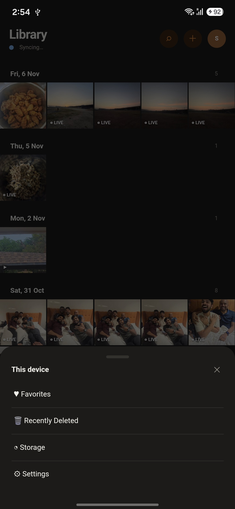 Avatar sheet hiding Favorites, Storage, Settings | Four tabs, Settings among them; every item has a real place ([01](mockups/01-navigation.html)) |
| 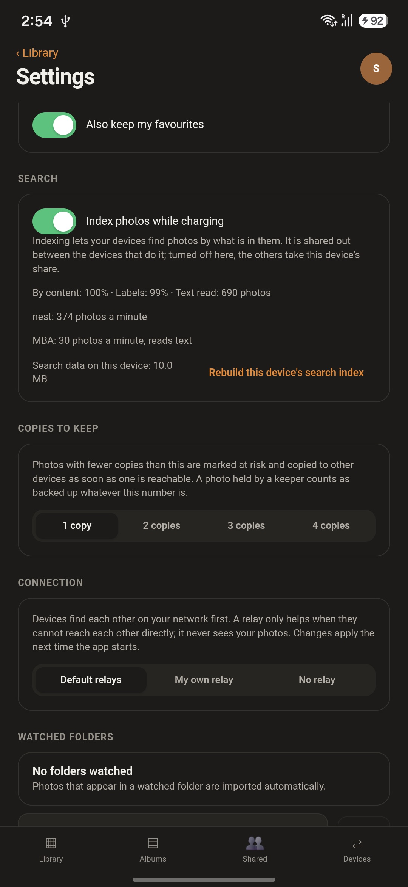 Desktop path fields on the phone | Advanced; desktop-only items hidden on phones ([06](mockups/06-settings.html)) |
| 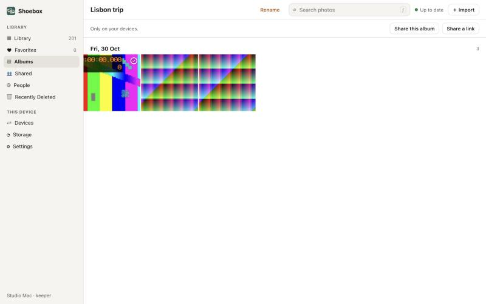 Two share buttons, no cover, no Add photos | One header: cover, Add photos, Share ([04](mockups/04-albums-sharing.html)) |

### Why Settings is a tab and Backup is not

An earlier draft gave Backup the fourth tab and put Settings behind a gear on it. The owner reviewed it and chose the opposite, for these reasons:

- **The daily safety answer already lives on Photos.** The status chip says "All backed up", "Backing up 23" or "Mac offline · 3 days", and opens the Backup page. A Backup tab would mostly repeat it.
- **People expect to find Settings without hunting.** A gear inside another screen is not obvious.
- **Backup becomes the first section of Settings, not a buried row.** The safety sentence, the Camera backup toggle and Devices sit at the top of the tab, so the details are one tap from Photos (chip) and one tap from the tab bar.
- **Warnings still get through.** When photos are at risk, Photos shows a banner, the chip turns amber or red, and the Settings tab gets a dot.

On the Mac nothing changes: the sidebar has room for both a Backup status row and Settings.

### What gets deprioritised, and where it goes

| Feature | Today | Redesign |
|---|---|---|
| Role choice (Keeper/Companion/Viewer) | Onboarding step + Add-device step | Chosen automatically; editable in device detail as "What it does" |
| Copies to keep | Settings, top half | Advanced → Library (also linked from Backup → Details) |
| Relays / connection | Settings | Advanced → This device |
| Rebuild index, diagnostics | Settings | Advanced |
| Replace phrase, leave library | Settings | Advanced, danger card |
| Make admin, remove device | Device detail sheet | Device page, shown only when it applies |
| Keep on this device | Viewer info + selection icon | Viewer ⋯ / selection More, hidden on keepers |
| Similar | Viewer top bar | Viewer ⋯ / desktop right-click |
| Web link setup | First thing in "Share a link" | Share → Web link, with "needs a service, set up once" explained |
| Long invitation/pairing codes | Shown in a textarea | Behind "Copy code"; send via system share or QR |
| Recently Deleted | Avatar sheet / sidebar | Bottom of Albums; desktop sidebar footer |
| Watched folders, Export | Settings (also on phone) | Mac Advanced only |

## Implementation plan

Five phases, each shippable on its own. They are split into 24 issues (U1-01 to U1-24, about 52 dev-days) in [`planning/epics/U1-ui-overhaul.md`](../../planning/epics/U1-ui-overhaul.md); the issue order there regroups the work slightly, so the status work comes before the navigation that shows it. File paths are relative to `apps/desktop-mobile/ui/src` unless noted.

### Phase 0: quick fixes (about 1–2 days, low risk)

_Issues: U1-01 to U1-05. Epic: [U1](../../planning/epics/U1-ui-overhaul.md)._

| Fix | Files |
|---|---|
| Apply the saved theme and text size at launch (F16) | `main.ts` (read `localStorage.theme` before mount), `Settings.svelte` |
| Define `--danger` (alias of `--risk`) or replace it (F25) | `app.css`, `components/WebLinkSheet.svelte` |
| Use one name: "Storage" in the UI, `#/storage` route with a `#/health` redirect, fix the Leave-dialog text "check Health first" (F18) | `Shell.svelte`, `MobileShell.svelte`, `screens/Settings.svelte` |
| Copy: plural helper everywhere ("1 copies"), "space.Photos" (F19). Change the Storage banner to "Every photo is on a keeper or on N devices" until Phase 2 replaces it (F1, interim) | `screens/Health.svelte` |
| Album cover fallback to the newest photo when `cover` is `None` (F6) | `apps/desktop-mobile/src-tauri/src/core.rs` (album listing), `Albums.svelte`, `Shared.svelte` |
| Mobile album title shows the album name; add Rename to its ⋯ (F7) | `MobileShell.svelte` / `Albums.svelte` |
| Hide Watched folders and Export on mobile (F4) | `Settings.svelte` (gate on the existing mobile flag) |
| Sheets consume Android Back (F13) | `components/Sheet.svelte` (push a history state on open, pop on close) |
| Light-theme status bar icons (F17) | Android `MainActivity` / Tauri window theme, `main.ts` |
| Search: blur on submit; clear the desktop query when leaving `#/search` (F14) | `components/SearchField.svelte`, `Shell.svelte` |
| Hide "Make admin" on admins and "Keep original" on keepers (F22) | `Devices.svelte`, `Viewer.svelte` |
| Add Share to the viewer (F2, the first part) | `Viewer.svelte`, `components/ShareSheet.svelte` |

**Verify:** run `#/dev` and the existing UI tests. Check by hand on the S25: Back closes a sheet, the theme survives a restart, covers appear.

### Phase 1: navigation and Settings regroup (about 1 week, medium risk)

_Issues: U1-06 (icons and type), U1-09, U1-10, U1-11 (navigation), U1-14 and U1-15 (Settings, after the Backup page). Epic: [U1](../../planning/epics/U1-ui-overhaul.md)._

- **Mobile tabs.**
  - Make the tabs Photos · Albums · Search · Settings and remove the avatar menu.
  - Put Favorites, People and Recently Deleted rows on Albums.
  - Add the Photos status chip. At first it reads the existing sync state and links to the Backup page, which can temporarily route to Devices.
  - The Settings tab opens with a Backup section (status line, Camera backup toggle, Devices, Storage) above the setting groups.
  - Files: `MobileShell.svelte`, `Albums.svelte`, `Library.svelte`.
- **Desktop sidebar.**
  - Group it as Photos / Favorites / People, then Albums (individual albums listed), then a footer with the Backup status row, Recently Deleted and Settings.
  - Files: `Shell.svelte`.
- **Settings.**
  - Split the page into seven group components with drill-in on mobile and a two-pane window on desktop. Add an Advanced page.
  - Move the Mac Photos card to Backup in Phase 2.
  - Files: `Settings.svelte` (split into `settings/*.svelte`), `BackupCard.svelte`.
- **Icons.**
  - Replace the emoji and glyph mix with one monochrome icon set (inline SVG, one `Icon.svelte`).
  - Files: `components/*`, `app.css`.
- **Labelled action bars.**
  - Selection bar: Share · Add to album · Favorite · More · Delete. Viewer bottom bar on mobile.
  - Files: `Library.svelte`, `Viewer.svelte`.

**Risk:** muscle memory for existing testers, so call it out in the CHANGELOG and tester guide. **Verify:**
- Walk every route in the mind map and confirm each one is still reachable, with depth ≤ the target in the "deprioritised" table.
- Update `docs/guides/tester-guide.md`.

### Phase 2: Backup, the single safety answer (about 1 week, medium risk, highest value)

_Issues: U1-07 (status), U1-08 (chip, sidebar, banners), U1-12 (Backup page), U1-13 (device page). Epic: [U1](../../planning/epics/U1-ui-overhaul.md)._

- **One status API.**
  - Add a `backup_status()` in `core.rs`. It returns `{state: safe|single_device|busy|waiting|at_risk, count, devices, since, reason}`.
  - It is built on the existing `at_risk` (`crates/shoebox-core/src/library_state.rs`) and `backed_up`, plus peer last-seen and queue data.
  - Everything reads it: the Photos chip, the sidebar row, banners, Backup hero and viewer Info.
  - Add ts-rs bindings.
- **Backup screen.**
  - Merge `Health.svelte` and the activity/queue/list parts of `Devices.svelte` into `Backup.svelte`: hero, device cards, Details (copies chart, queue, activity, free up), Add a device. On phones it is pushed from the Settings tab and from the Photos chip.
  - The desktop gets Overview / Devices / Storage tabs.
- **Viewer Info.**
  - Replace "N copies · wants M" with "Backed up · on X and Y" / "Waiting for X" / "Only on this phone".
- **Device page.**
  - Use plain-language rows. Show admin and role actions only when they apply.
  - Add a device shows the QR first, with the role defaulted by device type.

**Risk:** the wording has to stay true in edge cases (revoked keepers, devices not seen for months). Write unit tests for `backup_status` covering each state, including the one-keeper library and the keeper-offline case. **Verify:** run the demo library and the 3-device live library, and confirm all four surfaces say the same thing.

### Phase 3: Albums and Shared unification, one viewer, the share sheet (about 1–2 weeks, higher risk)

_Issues: U1-16 (viewer), U1-17 (selection bar), U1-18 (timeline), U1-19 to U1-21 (albums and sharing). Epic: [U1](../../planning/epics/U1-ui-overhaul.md)._

- **One list.**
  - Merge `Albums.svelte` and `Shared.svelte`, with an All / Mine / Shared filter on desktop and a pill on mobile.
- **One album page.**
  - The header holds cover, name, members, Add photos, Share and ⋯. A shared album adds an Activity tab.
  - `SharedAlbum.svelte` keeps its activity and people panes but opens photos in `Viewer.svelte`, with comments in Info.
- **Share sheet.**
  - Selection: system share first, then Add to shared album and Web link.
  - Album: Invite people / Web link / Send copies.
  - Web link with no service set up explains the service, then asks one question at a time.
  - Files: `ShareSheet.svelte`, `WebLinkSheet.svelte`.
- **Invitations.**
  - Send through the system share sheet as a deep link that Shoebox opens, with QR second and the raw code behind "Copy code".
  - This needs a link format the app handles. Check it against the pairing and invite security notes, since the code is still the secret.
- **Albums tab.**
  - Show an invitation card for a pending invite.

**Risk:** shared-album permissions and the deep-link handling. **Verify:**
- Two-device invite and join on the demo libraries (`desktop-ui` and `desktop-ui-b` configs).
- Use the existing `apps/desktop-mobile/src-tauri/tests`.

### Phase 4: first run and empty states (about 3–5 days, low to medium risk)

_Issues: U1-22 (first run), U1-23 (empty states), U1-24 (docs and re-measure). Epic: [U1](../../planning/epics/U1-ui-overhaul.md)._

- **Onboarding.**
  - Remove the role step. Make the recovery kit postponable, with a persistent banner and an "at risk" state until it is saved.
  - Add a final "Bring your photos in" step: camera backup on by default on phones, Add a computer, Google import.
  - Files: `Onboarding.svelte`, `RecoveryKit.svelte`.
- **Empty states.**
  - Photos while importing, a one-device Backup, no albums, no search results, People off.
- **Decision for the owner.**
  - Making the kit postponable trades safety for a faster start.
  - Option one: postpone only after camera backup is on.
  - Option two: keep the kit blocking and only reword it.

**Verify:** run a fresh profile on desktop and phone and time first launch to first photo. Target under 60 s, excluding import.

### Afterwards: measure it

There is no analytics in Shoebox by design. Re-run this audit with 3–5 testers on the [tester guide](../../docs/guides/tester-guide.md) tasks: "Send this photo to a friend", "Are your photos safe right now?", "Put these in an album and invite someone", "Turn off backup on mobile data". Count taps and wrong turns, before and after each phase.

## Not covered live

These were read from code, not seen on a device:

- the six-digit pairing check
- change role, remove device, replace phrase and leave-library confirmations
- deletion confirmations
- the gallery-deletions prompt and the recovery-request prompt
- Google import progress and report
- at-risk banners on the real library
- the Mac-only Photos library card and native pickers (the desktop tour used the dev server)

Details are in [capture-log.md](capture-log.md).
