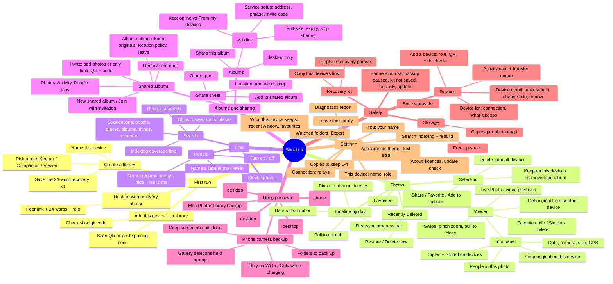

# Shoebox — UX mind map (as built, Nov 2026)

Everything a person can see or do in the desktop (macOS) and phone (Android) app today.
Tags on each leaf: **platform** `D` desktop · `M` phone · `DM` both, **depth** = taps/clicks from the app's home screen, **use** = how often a typical person needs it (`daily` · `weekly` · `monthly` · `rare` · `once`).

An interactive, collapsible version is in [mindmap.html](mindmap.html).

## Outline with tags

### 1. First run (`once`)
| Feature | Platform | Depth | Use | Notes |
|---|---|---|---|---|
| Welcome: create / add this device / restore | DM | 0 | once | Three equal-looking doors; "restore" is a text link |
| Name this device + **role picker** (Keeper / Companion / Viewer) | DM | 1 | once | Jargon before the person has any context |
| Recovery kit (24 words, file / copy / print, confirm checkbox) | DM | 2 | once | Mandatory before entering the app |
| Join: scan QR / paste `shoebox-pair1…` code → six-digit check | DM | 1–2 | once | |
| Restore: peer link + 24 words + role | DM | 1 | rare | Needs another device to approve within 2 min |

### 2. Photos (`daily`)
| Feature | Platform | Depth | Use |
|---|---|---|---|
| Timeline grouped by day, pinch density, date rail, pull-to-refresh | DM | 0 | daily |
| Viewer: swipe, zoom, close; ♥ ⓘ ≈ 🗑 in top-right | DM | 1 | daily |
| Viewer info: date, camera, copies, stored-on, people, keep original | DM | 2 | weekly |
| Live Photo / video | DM | 1 | daily |
| Selection: long-press/drag (M), ⌘/⇧-click (D) | DM | 1 | weekly |
| Selection bar: share, ♥, add to album, keep here, delete (icons only) | DM | 2 | weekly |
| Favorites | D sidebar / M avatar menu | 1 / 2 | weekly |
| Recently Deleted (restore, delete now) | D sidebar / M avatar menu | 1 / 2 | rare |

### 3. Find (`weekly`)
| Feature | Platform | Depth | Use |
|---|---|---|---|
| Search field (`/`, ⌘F) with recents + suggestions | D toolbar / M header icon | 0 / 1 | weekly |
| Chips for dates, kinds, places, people, cameras | DM | 1 | weekly |
| Similar photos (≈ in viewer) | DM | 2 | monthly |
| People grid; name, rename, merge, hide, "This is me" | D sidebar / M Albums → People | 1 / 2 | monthly |
| Name a face from the viewer info panel | DM | 3 | monthly |

### 4. Albums & sharing (`weekly` / `monthly`)
| Feature | Platform | Depth | Use |
|---|---|---|---|
| Albums grid + inline "New album name" field | DM | 1 | weekly |
| Album: Share this album / Share a link / Rename (D only) | DM | 2 | monthly |
| Shared albums list: new, join with invitation | DM | 1 | monthly |
| Shared album: Photos / Activity / People tabs, Add photos, Invite, ⚙ | DM | 2 | monthly |
| Invite: role, QR + long code, copy | DM | 3 | monthly |
| Album settings: keep originals, location policy, leave | DM | 3 | rare |
| Web link: service address + phrase + invite code setup, then online/devices, full size, expiry | DM | 3 | rare |
| Share sheet from selection: new shared album / existing / Other apps | DM | 3 | weekly |

### 5. Bring photos in
| Feature | Platform | Depth | Use |
|---|---|---|---|
| Camera backup toggle, folders, Wi-Fi / charging | M (Settings top) | 2 | once, then glance |
| Mac Photos library backup | D (Settings top) | 1 | once |
| Import files / folder, From Google Photos… | D toolbar | 1 | monthly |
| Add photos: from gallery / from files | M header ＋ | 1 | rare |
| Google Takeout import (plan → running → stopped → report) | D | 2 | once |
| Watched folders | D (Settings; also shown on phone with a typed path) | 2 | rare |

### 6. Safety (`weekly` glance, `rare` action)
| Feature | Platform | Depth | Use |
|---|---|---|---|
| Sync status dot / line | D toolbar / M Library header | 0 | daily glance |
| Banners (one at a time): at risk, backup paused, camera backup off, kit not saved, security, update, Takeout stopped | DM (fewer on M) | 0 | as needed |
| Storage: stat cards, copies-per-photo chart, free up space | D sidebar / M avatar menu | 1 / 2 | monthly |
| Devices: activity card, queue, list, add device, detail, role, admin, remove | DM tab/sidebar | 1 | weekly glance |
| Recovery: copy device link, replace phrase | Settings | 2 | rare |

### 7. Settings (one long page, 14 sections, ~4.5 phone screens)
Backup card · You · This device · What this device keeps · Search · Copies to keep · Connection · Watched folders · Export · Help · Appearance · Recovery · Leave this library · About.
Daily/weekly items (backup state) sit next to rare and dangerous ones (relays, replace phrase, leave library) with the same visual weight.

### 8. System surfaces
Toasts (4 s) · global pairing prompt (six-digit check) · "Let this device in?" recovery request (desktop only) · gallery-deletions prompt (phone) · update banner (desktop only) · security alerts (desktop only).
